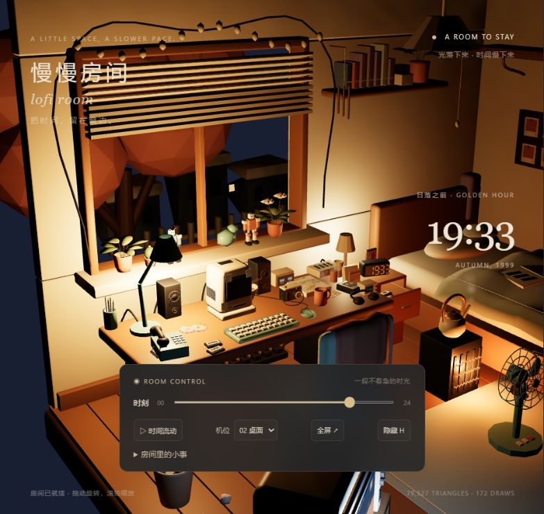
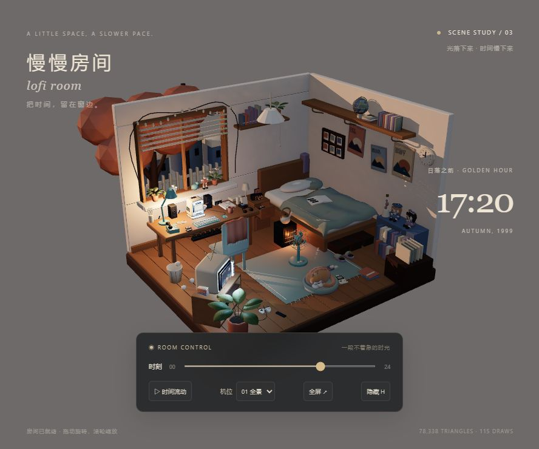
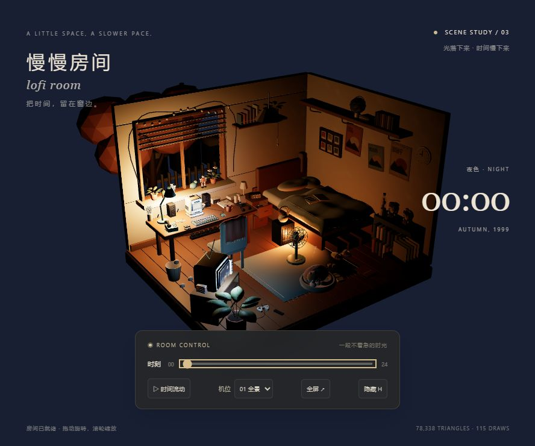

# 3d-lofi-room

> A little space, a slower pace.

一个可以旋转、探索和互动的 3D Lofi 房间（场景名仍是「四季房间 · Lofi Room」）：黄昏的光从百叶窗之间落进来，老 Macintosh 的终端在滚动，CRT 电视可以打开网页，风扇、植物、音响、蒸汽和窗边风铃让这个小房间一直有呼吸。

项目在此基础上向「多场景」演进：当前只有这一个房间，后续每个新场景会自带模型、文档与机位，共用同一套运行时（见 [场景与目录约定](docs/scenes.md)）。



## 参考原作

本项目的起点是原作的房间设计与其产出物，原作声明保留如下：

- 原作仓库与下载：[**ACKEYTLC/lofi-room_by_Astra**](https://github.com/ACKEYTLC/lofi-room_by_Astra)（Releases 中的 Windows 便携版仍指向此处）
- 本仓库（3d-lofi-room）在原作基础上继续开发：重命名项目、把运行时拆成可复用模块（光照贴图混合、自适应分辨率、加载进度、演示模式作息、太阳阴影节流等），并准备接入更多场景。
- 模型与贴图均由本仓库自己的 Blender 源（`blender/lofi_room.blend`）经 `scripts/export_glb.py` 导出，管线约定见 [`AGENTS.md`](AGENTS.md)。

## 现在就试试

前往 [Releases](https://github.com/ACKEYTLC/lofi-room_by_Astra/releases) 下载最新版 Windows 便携版。下载后双击 EXE 即可运行，不需要安装 Blender、Node.js，也不需要启动网页服务器。

如果你想在线查看项目文件，可以直接浏览本仓库；如果想运行网页开发版，请参考仓库中的构建说明，并把项目放在你自己的工作目录中。

> Windows 版本是未签名的开发体验版，系统可能会显示安全提示。

## 房间里有什么

| 角落 | 细节 |
| --- | --- |
| 书桌 | Macintosh 终端、果冻键鼠、电话、相机、拍立得、Modem、CD、磁带和多根可见电线 |
| 电视柜 | CRT、VCR、初代游戏机、手柄和原创像素演示画面 |
| 窗边 | 黄昏天空、树影、绿植、机甲摆件、百叶窗和风铃 |
| 床与地板 | 橘猫、软垫、漫画、拖鞋、垃圾桶、Game Boy 和散落的生活痕迹 |





## 可以做什么

- 拖动旋转房间，滚轮缩放
- 机位可在「全景 / 桌面 / 窗边 / 电视」四档之间切换，其中「电视」是坐在 CRT 正前方的视角（列表直接在面板里展开，不用系统弹窗）
- 点击上层抽屉、风扇、电话、台灯、床头灯、吊灯（顶灯）、串灯、地球仪、百叶窗、垃圾桶和窗台机甲
- 风扇在停止、慢速、快速三档之间切换；转起来就会自己左右摆头（档位越高摆得越快、幅度越大，停下后扇头自己摆正），底座三个按键会跟着亮：静止时右边那颗红的，慢速亮左边、快速亮中间
- 电脑终端、CRT、示波器、音响、植物、蒸汽和风铃持续产生轻微动态
- 调整房间时刻，从清晨到深夜连续变化：清晨是掺了雾的粉桃色晨曦，傍晚是更红更重的橙红夕阳（两条色路，不是同一种黄昏）；低太阳会贴地平线掠进窗户，把影子拉满整块地板；墙上的挂钟指针跟着这个时刻走（时针随分钟缓慢爬行）
- 点开底部的圆环按钮展开控制台，按每盏灯、每块屏幕单独调开关与强度；点 ⟲ 收起面板并把圆环放回默认位置
- 串灯可以在控制台里选颜色、调节奏，并叠加「自动变色」「顺序点亮」；点「彩虹」后每个灯泡各自一种颜色，沿灯串渐变过渡，顺序点亮的亮点从彩虹中穿过；也可以直接点窗边的串灯（灯泡或那根电线都行）开关
- 地球仪的陆地一直带着一点微弱的光（海洋保持暗色），白天夜里都亮着；机位 / 季节 / 窗外都是面板内联的下拉列表，点一下直接选
- 打开「展示模式」让房间自己演一天：天黑后路灯、熔岩灯和串灯（彩虹 + 顺序点亮）亮到天亮，室内的灯按工作与休息的作息自动开关，屏幕、风扇、暖炉与窗帘也跟着变——早上床头灯亮起之后再拉开窗帘，晚上先拉上窗帘再熄台灯；每过一天自动换到下一个季节，天气重新随机（只在该季节合法的天气里选）
- 首次打开就是上午 11:30 且展示模式已开启，房间已经开始自己过日子；想手动接管就关掉「展示模式」，开关与强度全部交回控制台
- 画面清晰度自适应：机器跑得动时会渲染到基础分辨率的 2 倍（超采样，细小物件不再有锯齿），吃力时自动降下来，窗口尺寸不会被改动
- 进屋前左下角会提示正在加载什么、走到百分之几与已下载多少 MB；网络慢会说明仍在继续，加载失败会给出「重试 ↻」按钮；进屋后同一行接着提示「拖动旋转 · 点底部圆环开控制面板，也可直接点房间里的模型互动」
- 手机 / 平板可直接用手指拖动旋转房间：进入全屏、横竖屏切换、地址栏收起之后都能继续拖动（画布尺寸会重算，手势也不会被浏览器的下拉刷新抢走）
- 播放原创 Lofi 曲目《窗边留座 / Window Seat》

## 开发者运行

本项目使用 **pnpm** 管理依赖（Node.js ≥ 20，pnpm ≥ 10）。首次使用可执行 `corepack enable`，或全局安装：

```powershell
npm install -g pnpm
```

然后在项目目录安装依赖并启动开发服务器：

```powershell
pnpm install
pnpm dev
```

然后打开终端显示的本地地址。开发服务器优先使用 `5174` 端口，若被占用会自动递增到下一个空闲端口（终端打印的 `Local:` / `Network:` 就是实际端口）。开发服务器同时监听局域网，同一 Wi-Fi 下的手机或平板可以直接打开打印出来的 `Network: http://<局域网 IP>:<端口>/`（只监听本机时可运行 `pnpm dev --host 127.0.0.1`）。生产构建和测试：

```powershell
pnpm typecheck
pnpm build
```

## 项目特点

- Blender 源文件是唯一事实来源，网页使用导出的 GLB
- Three.js/WebGL 实时渲染
- 统一的低饱和暖色调和微缩模型比例
- 79,803 个三角面，适合实时预览
- 原创屏幕画面、原创 BGM，不使用第三方游戏截图或歌曲采样
- 包含完整的建模、导出、光照烘焙和验证脚本

## 接下来想做什么

这个房间已经能陪你安静地待一会儿，下一步会把它做得更像一个真正的学习桌面：

- **更有存在感的天气**：让雨、雪、雾、风和窗外光线在画面中更明显地变化，并影响植物、风铃和室内氛围。
- **自己的音乐**：加入本地音乐文件或歌单导入，让房间可以播放你喜欢的 Lofi、爵士或环境音乐。
- **前台播放器**：做一个可以常驻在桌面上的小型播放器 UI，支持播放、暂停、上一首、下一首、音量和进度显示。
- **番茄钟**：加入专注、短休息和长休息计时，让房间从可观赏的场景变成真正能陪你学习的空间。
- **更多生活事件**：继续扩展猫咪行为、屏幕内容、季节变化和房间里的小互动。

这些方向会优先保持现在的气质：安静、克制、容易长时间使用，不把房间变成信息过载的控制台。

## 技术资料

- [运行时记录](docs/runtime-progress.md)
- [桌面版与打包说明](docs/desktop.md)
- [资产清单](docs/asset-list.md)
- [美术方向](docs/art-direction.md)
- [Blender → GLB 工作流](AGENTS.md)

## 当前状态

这是一个持续打磨中的个人作品。当前版本已经完成核心场景、材质、动画、交互、原创音乐和 Windows 便携版。天气变化还不够明显，也暂时不能导入自己的歌单；前台播放器、番茄钟和更多猫咪行为会在后续版本中加入。

Made with Blender, Three.js, and a lot of late-night room light.
